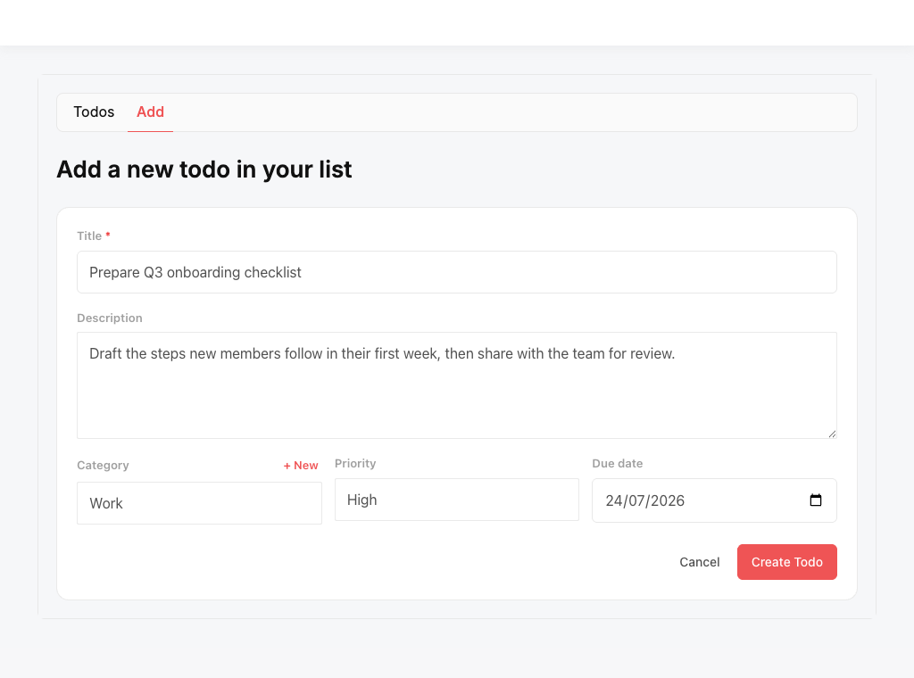

# Add a to-do

Beyond the quick-add field on the list, a full Add form is available for creating a task
with all its details at once (the To-do tab's Add sub-page, or a group's Add sub-tab).

## Fields

| Field | Required | Notes |
|---|---|---|
| Title | Yes | Rejected by the client and the REST API if empty. |
| Description | No | Shown later via [Task details](task-details). |
| Category | No | Existing categories, plus an inline creator if allowed (see below). |
| Priority | No | Critical, High, or Normal. Defaults to Normal. |
| Due date | Depends | Required when the **Require due date** setting is on. |

## Inline category creation

When the site owner enables **Member-created categories**, the form shows a "+ New" link
next to the Category field. Selecting it reveals a name field and an Add button that
creates the category through `POST /categories` and auto-selects it, without leaving the
form. Admins (with `manage_categories`) can always add categories regardless of the
setting. See [Categories](categories).

## Require due date

When **Require due date** is on in settings:

- The modern form marks the due-date field required and blocks submission client-side
  until a date is chosen.
- The REST API enforces the same rule server-side: `POST /todos` and
  `POST /groups/{id}/todos` return `400 bptodo_due_required` if `due_date` is missing.

This keeps the rule enforced consistently, whether a request comes from the form, a
custom integration, or a future client.
