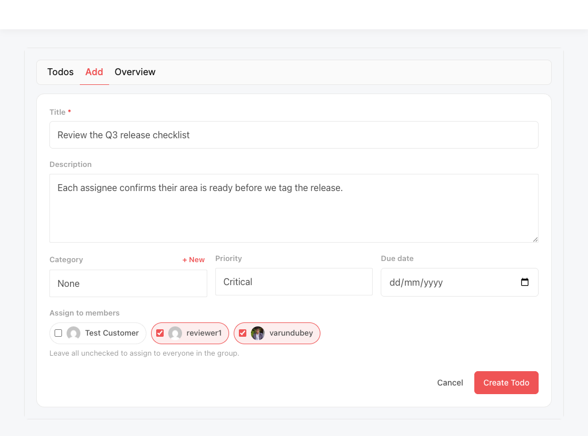
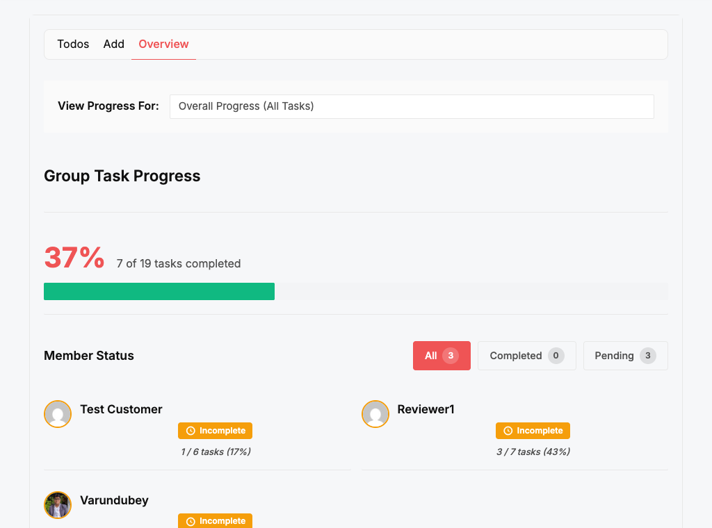

# Group to-dos

BuddyPress and BuddyBoss groups get a Todos tab with three sub-tabs: **Todos**, **Add**,
and **Overview**. The tab only appears when group todos are enabled in
[Admin settings](../settings/admin-settings) and not disabled for that specific group.

## Todos

The default sub-tab lists the group's shared tasks using the same modern list described
in [Modern personal to-do list](modern-todo-list) (or the legacy list in Classic mode).

## Add

Visible to group admins, and to moderators when the "moderators can add" setting allows
it (or to site admins always). The Add sub-tab is the same form as
[Add a to-do](add-a-todo), plus an **Assign to members** section:

- Check specific members to assign the task only to them (a chip-style picker with
  member avatars).
- Leave every member unchecked to assign the task to everyone in the group.

Assigning to specific members requires group admin/moderator permission; any confirmed
group member can create an unassigned group task if group settings allow it.

## Overview

Visible to group admins, and to moderators when the "moderators can view report" setting
allows it. Overview shows per-member completion progress: total tasks, completed,
pending, and a completion percentage per member, ranked so members needing attention
surface first.

Filter the member list by **All**, **Completed**, or **Pending** to focus on who still has
outstanding work.
