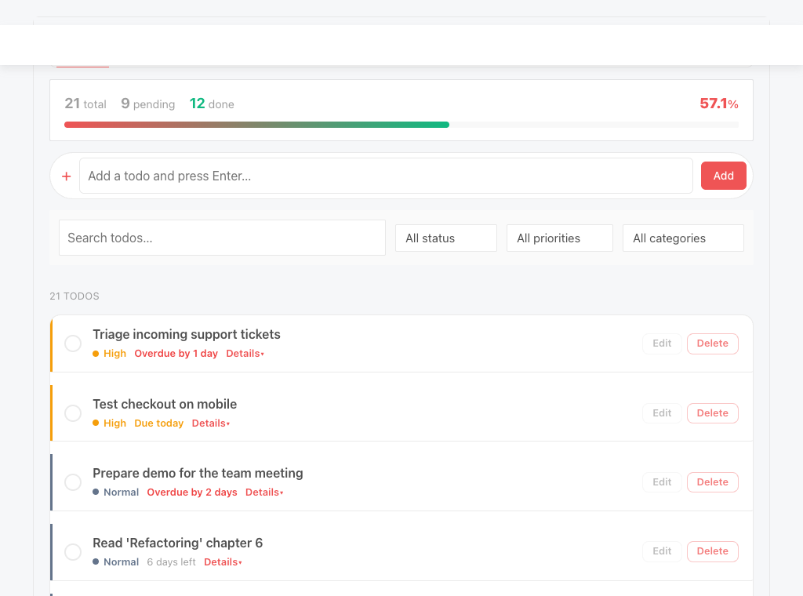
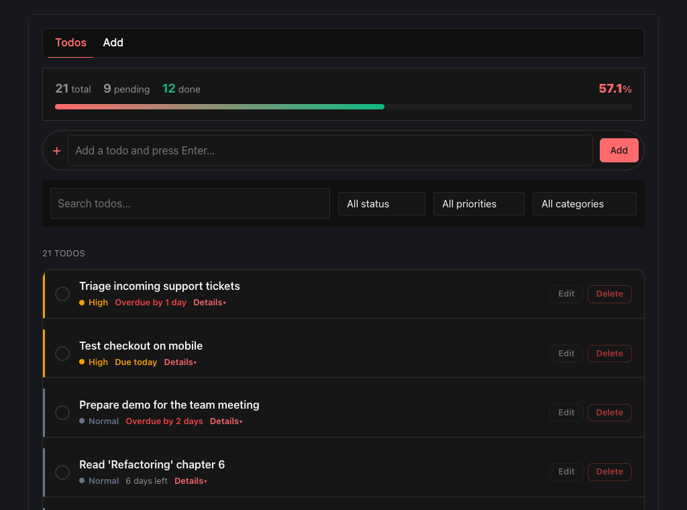

# Modern personal to-do list

The Modern layout renders each member's tasks as a fast, no-reload list powered by the
WordPress Interactivity API and the `bptodo/v1` REST API.

## Progress summary

A summary bar at the top shows total tasks, pending count, done count, and a completion
percentage, with a progress track that fills as tasks are completed.

## Quick-add

Type a task title in the quick-add field and press Enter to create it immediately. The
placeholder and the singular label use your configured [Todo label](../settings/admin-settings)
(for example "Add a task and press Enter...").

## Inline complete and undo

Check the box next to a task to mark it complete; uncheck it to undo. Both actions call
the REST API directly and update the summary counts without a reload.

## Inline edit

Selecting Edit on a task opens an inline form for:

- Title
- Details (description)
- Priority (Critical, High, Normal)
- Due date

Saving sends a single REST `PATCH` request and refreshes the row in place.

## Delete with inline confirm

Delete shows an inline Yes/No confirmation next to the task row instead of the browser's
native confirm dialog, so the accessible confirm matches the rest of the UI. Confirming
removes the task and refreshes the stats.

## Search, filter, and pagination

- **Search** is debounced as you type and filters across every page of results, not just
  the current page.
- **Filters** for status (all/pending/completed), priority, and category narrow the list
  server-side.
- **Pagination** uses Previous/Next controls; each page change is a single REST call.

## Dark mode

The modern list follows your theme's dark mode (BuddyX/Reign `data-bx-mode="dark"`), using
design tokens rather than hardcoded colors.

