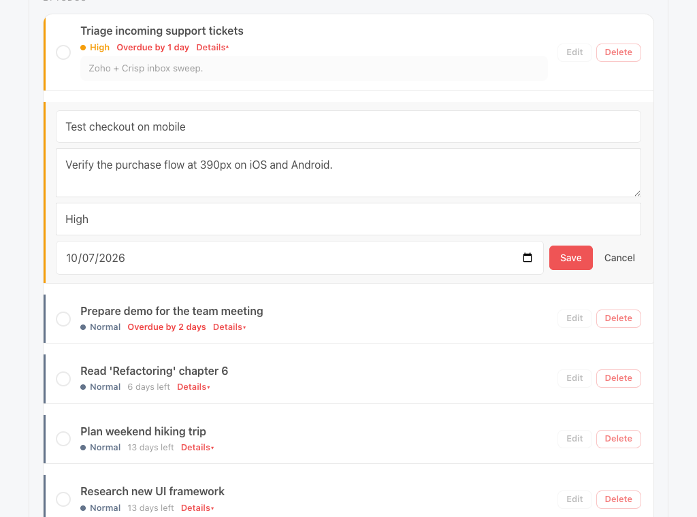

# Task details and notes

Any task can carry a longer description (its "details" or notes), set from the
[Add a to-do](add-a-todo) form's Description field.

## Viewing details

When a task has a non-empty description, its row shows a **Details** toggle next to the
priority and due-date text. Selecting it expands an inline note beneath the task, without
navigating away from the list.

## Editing details

Inline edit includes a Details textarea alongside title, priority, and due date. Changes
are prefilled from the current description and saved with the same REST `PATCH` request
used for the rest of the inline edit form.

## Why this matters

Earlier 4.0 builds accepted a description on the Add form and returned it from the REST
API, but the modern list never displayed it, and the old single-task page that used to
show it is now private (see [Privacy](privacy)). The Details toggle and inline-edit field
restore that context entirely inside the permission-scoped list view.
