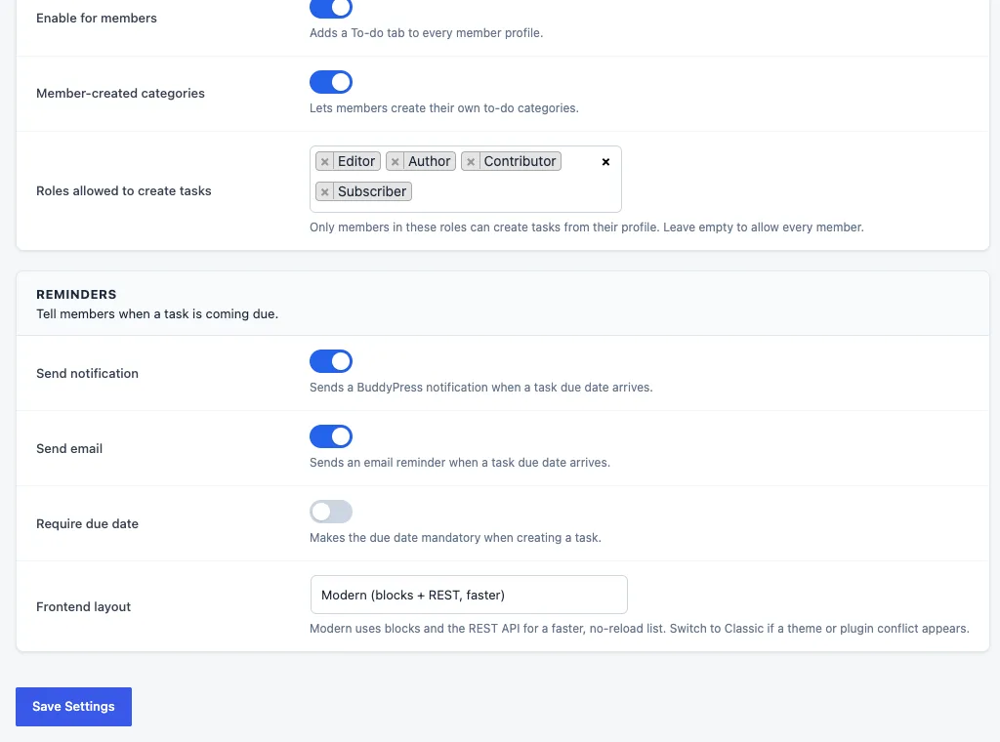

# Modern vs. Legacy layout

Version 4.0 ships a new **Frontend layout** setting under Settings → Todo List → General.



## Modern (default)

- Uses the WordPress Interactivity API and the `bptodo/v1` REST API.
- Add, complete, edit, delete, filter, search, and paginate without a page reload.
- Same underlying data as Legacy: status, priority, due date, category, and group
  assignment are stored the same way in both modes.

## Classic (legacy)

- The original jQuery + admin-ajax templates and full-page forms.
- Kept fully working, not deprecated. Every AJAX handler, template, and nonce from
  earlier versions still runs when Classic is selected.
- Useful if a theme or another plugin conflicts with the modern frontend.

## Switching modes

Open Settings → Todo List → General and change **Frontend layout** to Modern or Classic,
then save. The switch is instant and lossless: both modes read and write the same tasks,
so nothing is exported, imported, or lost when you switch back and forth.

## Automatic fallback

`bptodo_layout_mode()` automatically returns Classic when the site's WordPress version or
active theme does not support the block/Interactivity runtime (for example, WordPress
older than 6.5). This means the Modern default never breaks an older site; it degrades
to the layout that was already working.

## Developer override

Use the `bptodo_layout_mode` filter to force a mode per site or per surface (member tab,
group tab, or shortcode context):

```php
add_filter( 'bptodo_layout_mode', function ( $mode, $context ) {
    if ( 'group' === $context ) {
        return 'legacy';
    }
    return $mode;
}, 10, 2 );
```
