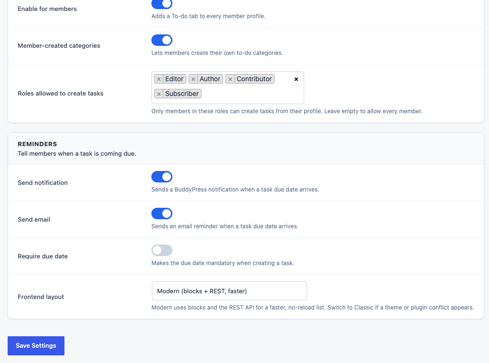

# Admin settings

Settings live under **Settings → Todo List** (in the shared Wbcom Plugins admin menu),
General tab. They are stored in the `user_todo_list_settings` option.

## Labels

| Setting | Description |
|---|---|
| Todo Label (Singular) | The word used for one task (default "Todo"). Drives the modern list count, quick-add placeholder, empty state, and the Add form's Create button. |
| Todos Label (Plural) | The word used for multiple tasks (default "Todos"). Also renames the member/group profile tab. |

## Member access

| Setting | Default | Description |
|---|---|---|
| Enable for members | Off | Adds a To-do tab to every member profile. |
| Member-created categories | Off | Lets members create their own to-do categories (an inline "+ New" control on the Add form). Admins can always add categories. |
| Roles allowed to create tasks | Everyone | Restrict task creation to specific roles. Leave empty to allow every member. |

## Reminders

| Setting | Default | Description |
|---|---|---|
| Send notification | Off | Sends a BuddyPress notification when a task's due date arrives. |
| Send email | Off | Sends an email reminder when a task's due date arrives. |
| Require due date | Off | Makes the due date mandatory when creating a task, enforced on both the form and the REST API. |

## Frontend layout

| Setting | Default | Description |
|---|---|---|
| Frontend layout | Modern | Modern uses blocks and the REST API for a faster, no-reload list. Classic uses the legacy templates. See [Modern vs. Legacy layout](../getting-started/modern-vs-legacy). |

## Group settings

Group-level toggles (group-todo-list-settings option, on the Group tab) control whether
the group Todos tab appears, whether moderators can add tasks or view the Overview
report, and whether modification is restricted. See [Group to-dos](../features/group-todos).
